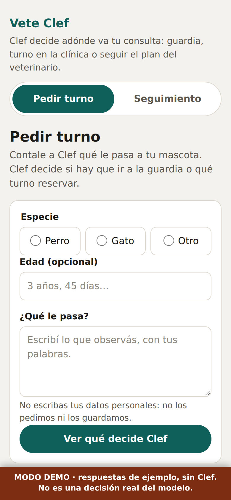
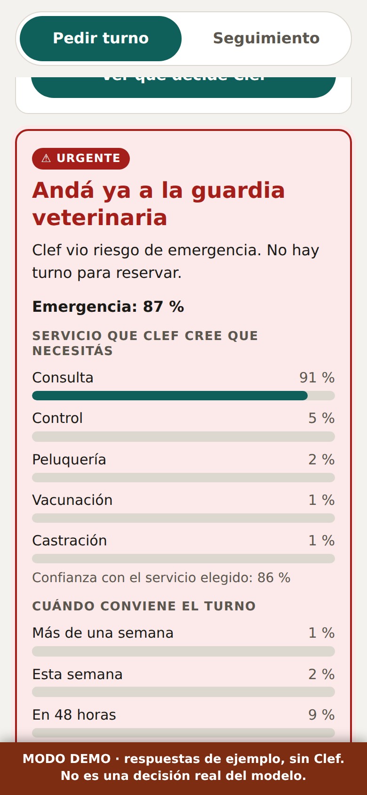
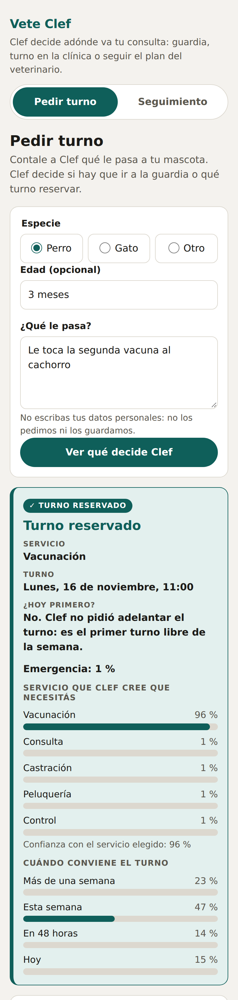
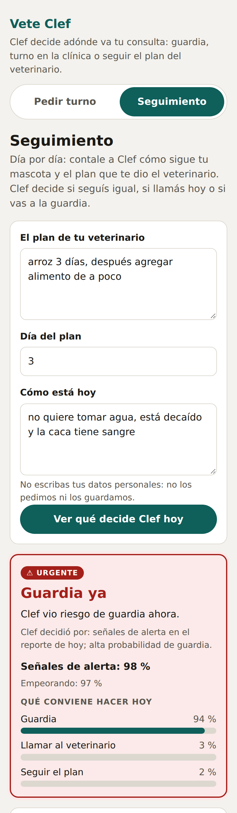
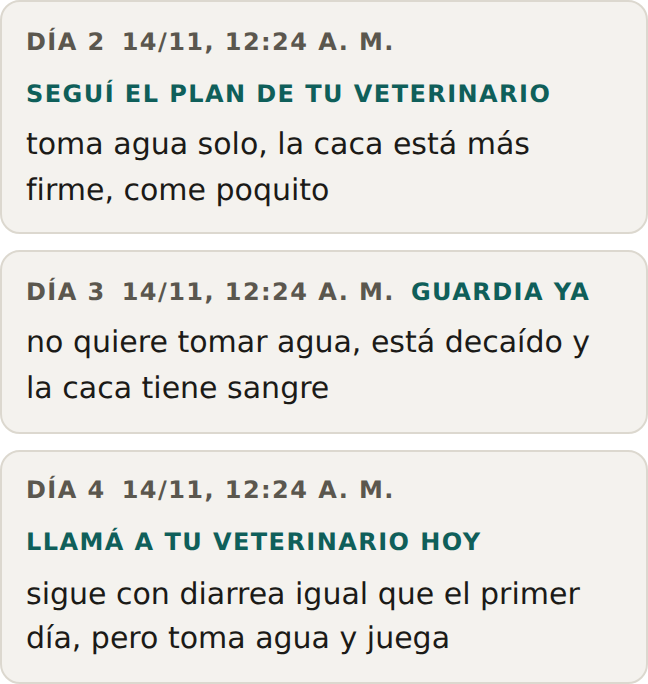

Categoría: Tema libre

# Vete Clef

Un asistente para una clínica veterinaria donde **Clef toma la decisión**: el dueño describe a su mascota con sus palabras y la app decide qué pasa después. Clef no diagnostica ni receta; decide **a dónde va el caso** y **cuándo hay que escalar a un veterinario**.

> Esta herramienta no reemplaza al veterinario. No da diagnósticos ni dosis. Ante la duda, consultá.

**Demo en vivo:** <https://vete-clef.lfdm-deieme07.workers.dev>

## La historia

Un cachorro de Dogo Argentino de 45 días con diarrea. El veterinario indicó arroz tres días y después ir agregando alimento de a poco. El problema no era el plan: era que el dueño, día por día, no sabía **si seguir con el plan o llamar al veterinario**. Dudar de más también es un riesgo.

Vete Clef es esa respuesta, pero decidida por un modelo de decisión y no por la intuición del dueño a las tres de la mañana.

## Qué hace

Dos pantallas, en español, pensadas para el teléfono.

**Pedir turno.** El dueño elige especie, escribe la edad y cuenta qué pasa. Una sola llamada a Clef responde tres preguntas y la app aplica las reglas:

- Si hay riesgo de emergencia, pantalla roja: «Andá ya a la guardia veterinaria». No se reserva nada.
- Si no, se reserva el primer turno libre del servicio que Clef eligió.
- Si Clef duda del servicio, se muestran los dos más probables y elige el dueño.
- Si alguien pide peluquería pero hay señales de salud, el caso pasa a consulta y la app explica por qué.

**Seguimiento.** El dueño pega el plan del veterinario, el número de día y cómo ve a la mascota hoy. Clef responde si hay señales de alarma, si está empeorando y qué conviene hacer: «Guardia ya», «Llamá a tu veterinario hoy» o «Seguí el plan de tu veterinario». El plan se repite tal como lo escribió el dueño: la app nunca agrega consejo médico propio. Cada día queda guardado para ver la evolución.

## Capturas

Tomadas en un iPhone 14 emulado (390×844). **Están en modo demo**: Clef todavía no está habilitado en esta cuenta, así que el Worker respondió con un juego de respuestas sintéticas para poder recorrer la app entera. La validación, las reglas de decisión y las pantallas son el código real; lo único reemplazado es el viaje a Clef. Se regeneran en cuanto el modelo esté disponible, para que muestren la corrida real.

**Pedir turno** — la entrada y la regla de emergencia:

 

**Turno reservado** — las probabilidades de Clef a la vista, y el seguimiento con señales de alarma:

 

**Historial** — cada día queda guardado con la decisión que tomó Clef:



## Cómo decide Clef

Cada pantalla hace **una sola petición** a Clef (`POST https://api.nan.builders/v1/systemone`, `model: "clef"`) con tres preguntas tipadas.

| Pantalla | Pregunta | Tipo | Qué devuelve |
| --- | --- | --- | --- |
| Turno | `emergency` | `noul` | Probabilidad de que necesite la guardia ahora |
| Turno | `service` | `choice` | Consulta, vacunación, castración, peluquería o control |
| Turno | `timing` | `score` | De «más de una semana» a «hoy» |
| Seguimiento | `red_flags` | `noul` | Si hoy hay una señal de alarma |
| Seguimiento | `worse` | `noul` | Si está empeorando |
| Seguimiento | `action` | `choice` | Seguir el plan, consultar o ir a la guardia |

Los umbrales viven en un solo objeto (`src/config.js`) para poder calibrarlos:

| Regla | Umbral | Decisión |
| --- | --- | --- |
| Emergencia | `emergency >= 0.20` | Pantalla roja, sin turno |
| Urgencia | `timing.score >= 2.5` | Ofrecer primero el turno de hoy |
| Duda de servicio | `service.confidence < 0.5` | Mostrar los dos más probables |
| Peluquería con salud | `peluqueria` y `timing.score >= 1.5` | Pasa a consulta, con explicación |
| Alarma | `red_flags >= 0.30` o `p(guardia) >= 0.20` | «Guardia ya» |
| Empeoramiento | `worse >= 0.50` o `p(consultar) >= 0.35` | «Llamá a tu veterinario hoy» |
| Resto | — | «Seguí el plan de tu veterinario» |

El orden importa y está documentado: primero la seguridad (emergencia), después el override de peluquería, después la duda de servicio y al final la elección de turno. **Seguridad antes que confianza**: un pedido de peluquería con señales de salud no termina en peluquería ni aunque Clef esté poco seguro.

Las probabilidades se muestran en pantalla («Emergencia: 87 %»). La transparencia es parte del producto: el dueño ve cuánto se está jugando Clef en cada decisión.

## Correrlo en local

Necesitás Node.js 20 o superior.

```bash
npm install
echo 'NAN_KEY="tu-key-de-nan"' > .dev.vars
npx wrangler dev
```

`wrangler dev` levanta la app en `http://127.0.0.1:8787`. `.dev.vars` está en `.gitignore`: la key nunca entra al repositorio.

Para correr los tests no hace falta red ni key:

```bash
npm test
```

## Arquitectura

- Un solo Cloudflare Worker (`src/worker.js`) con assets estáticos servidos desde `public/`. HTML, CSS y JS planos: sin framework, sin paso de build.
- `POST /api/triage` y `POST /api/followup` validan la entrada, recortan el texto libre a 4000 caracteres y arman el `state` que ve Clef.
- Las reglas de decisión son funciones puras (`src/triage.js`, `src/followup.js`): reciben las respuestas de Clef y devuelven datos, sin red y sin copia de producto. Eso las hace testeables de verdad.
- `src/clef.js` es el cliente: una sola petición en vuelo (Clef lo exige), reintento único a los 1000 ms ante `429`, timeout de 50 s, y traducción de estados a errores amables. La key nunca aparece en un error ni en un log.
- Todo el texto del usuario se renderiza con `textContent`: no hay `innerHTML` con datos ajenos.
- La agenda es falsa y local (`localStorage`, envuelto en `try/catch`, con respaldo en memoria): no se guardan datos personales de nadie.

## Tests y calibración

`npm test` corre 66 tests con `node --test`, sin red. Las reglas se escribieron test-first y los fixtures están marcados como **sintéticos**: tienen la forma que documenta la API, pero no son respuestas grabadas de Clef.

Para calibrar los umbrales contra el Clef real, en serie y a mano:

```bash
NAN_KEY="tu-key-de-nan" node scripts/calibrate.mjs
```

El script corre los diez casos de `cases/cases.json` y muestra las probabilidades al lado de la ruta esperada, para ajustar umbrales con evidencia y no a ojo.

## Estado

- Reglas, endpoints, UI, agenda y tests: listos y verificados en local.
- **Acceso a Clef: pendiente.** La key actual de NaN responde bien para los modelos de chat, pero `model: "clef"` devuelve `404 model_not_found`. Hasta que el modelo esté habilitado en la cuenta, la app responde con «La key de NaN no tiene acceso al modelo Clef.» y la calibración no puede correr.
- **Capturas: listas**, tomadas en modo demo (ver arriba). Se regeneran cuando Clef esté habilitado para que muestren la corrida real.
